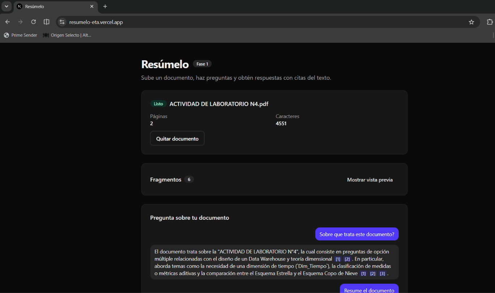
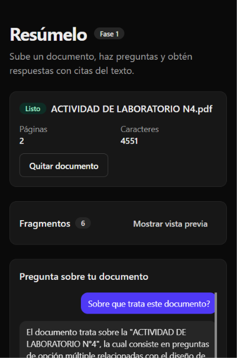
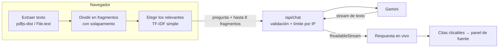

# Resúmelo

Aplicación web en español para subir un PDF o TXT, hacerle preguntas y recibir respuestas en streaming con citas al fragmento original del documento.

**Demo:** <https://resumelo-eta.vercel.app/>

[](https://github.com/FernandoHernandez19/resumelo/actions/workflows/ci.yml)

## Demo


| Escritorio | Móvil |
| --- | --- |
|  |  |

¿No tienes un PDF a mano? Usa el botón **Probar con un documento de ejemplo**.

## Qué hace

- Carga PDF o TXT (máx. 5 MB) con validación de tipo, tamaño y archivo vacío.
- Extrae el texto **en el navegador** y lo divide en fragmentos numerados con su página.
- Responde preguntas con Gemini en streaming, usando solo los fragmentos relevantes y citándolos como `[n]`.
- Convierte cada cita en un botón que abre el fragmento original y su página.
- Resume el documento con un botón, indicando si el resumen se basó en una muestra.

## Cómo funciona



## Decisiones técnicas

- **Extracción en el navegador.** El PDF se lee con `pdfjs-dist` (en un Web Worker) y el servidor nunca recibe el archivo: menos costo, sin límites de tamaño de petición, progreso en vivo y mejor privacidad.
- **Solo se envían fragmentos.** El cliente elige los fragmentos relevantes y manda únicamente la pregunta y esos fragmentos. El servidor lo exige: pregunta de 1 a 1000 caracteres, de 1 a 8 fragmentos y máximo 12 000 caracteres en total.
- **Key solo en el servidor.** `GEMINI_API_KEY` se lee únicamente en `src/lib/server/gemini.ts`, que importa `server-only`. Nunca hay variables `NEXT_PUBLIC_` y la key no se registra en logs.
- **Recuperación simple, sin base vectorial.** Los fragmentos se puntúan con una variante de TF-IDF (minúsculas, sin tildes, sin palabras vacías) y se envían los 6 mejores. Es rápida y no necesita infraestructura, pero solo coincide por términos exactos: no entiende sinónimos ni paráfrasis, y preguntas muy generales pueden recuperar fragmentos poco útiles.
- **Resumen por muestra.** Como el texto completo no viaja al servidor, el resumen usa el documento entero si cabe en los límites o, si no, hasta 8 fragmentos repartidos de forma uniforme (siempre el primero y el último). La interfaz lo indica: «Resumen basado en N de M fragmentos». Para escalar se haría *map-reduce*: resumir cada lote de fragmentos y luego resumir los resúmenes parciales.
- **Zustand en memoria.** El estado del documento y del chat vive solo en memoria, sin `localStorage` ni persistencia; al recargar la página se pierde.

## Seguridad y privacidad

- **Qué viaja:** al preguntar, la pregunta y los fragmentos relevantes (máx. 8 y 12 000 caracteres) van a nuestro endpoint y de ahí a Gemini. **Qué no viaja:** el archivo original y el texto completo del documento.
- **Qué guarda la app:** nada. No hay base de datos ni almacenamiento del contenido, y los logs de error no incluyen el contenido ni la IP. Esto no cubre lo que Google haga con las peticiones a la API de Gemini según sus propios términos, por eso conviene no subir información sensible.
- **Límites de entrada** validados en el servidor (respuesta 400 con un mensaje claro si se superan).
- **Limitador por IP de mejor esfuerzo:** 20 peticiones cada 10 minutos, en memoria, con respuesta 429. En un entorno serverless cada instancia tiene su propia memoria, así que el límite no es global ni estricto; protege contra abusos simples, no contra un ataque distribuido.
- **Key en variables de entorno** (`.env.local` en local y variables del proyecto en Vercel); `.env.example` no contiene valores reales.

## Límites conocidos

- Los PDF escaneados (imágenes sin texto seleccionable) no funcionan: no hay OCR.
- La capa gratuita de Gemini tiene cuota; cuando se agota la app responde «El servicio está ocupado».
- En documentos largos el resumen se basa en una muestra, no en todo el texto.
- La recuperación por términos puede fallar con sinónimos o preguntas muy abstractas.

## Probar en local

Requisitos: la versión de Node indicada en `.nvmrc` (22) y una API key de Gemini.

```bash
npm ci
cp .env.example .env.local   # y completa GEMINI_API_KEY (GEMINI_MODEL es opcional)
npm run dev                  # http://localhost:3000
```

Scripts útiles:

```bash
npm run lint
npm run typecheck
npm run test
npm run build
```

## Estructura del proyecto

```text
src/
├── app/
│   ├── api/chat/route.ts      # endpoint de chat y resumen (streaming)
│   ├── layout.tsx, page.tsx
├── components/
│   ├── chat/                  # panel de chat y citas clicables
│   ├── document/              # carga, resumen, fragmentos, fuente, aviso
│   └── ui/                    # design system: Button, Input, Card, Badge
├── lib/
│   ├── chunk.ts, extractText.ts, validateFile.ts   # procesamiento del documento
│   ├── retrieve.ts, citations.ts, summarySample.ts # búsqueda, citas y muestra
│   ├── chatClient.ts, chatLimits.ts
│   └── server/                # gemini.ts (server-only), chatPrompt.ts, rateLimit.ts
├── store/                     # Zustand: documento y chat
└── types/
public/ejemplo.txt             # documento de ejemplo
```

## Calidad

- Tests con Vitest y Testing Library (el SDK de Gemini y `pdfjs-dist` están simulados; nunca se llama a la API real).
- CI en GitHub Actions: lint, typecheck, tests y build en cada push a `main` y en cada pull request.
- Commits convencionales y un pull request por funcionalidad.

## Próximos pasos

- Resumen por partes (*map-reduce*) para cubrir documentos largos completos.
- OCR para PDF escaneados.

## Autor

Fernando Hernández — [github.com/FernandoHernandez19](https://github.com/FernandoHernandez19)
